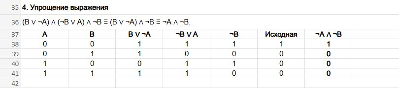
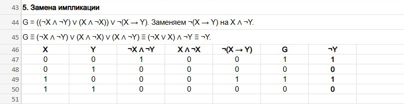
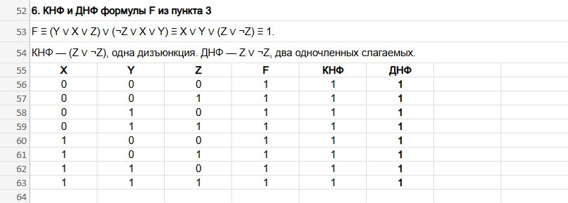
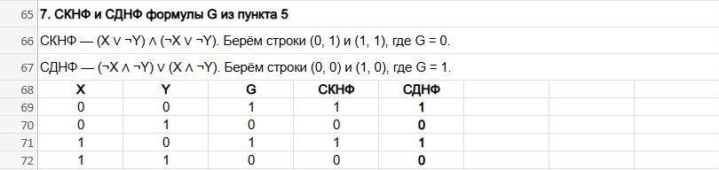

# Домашнее задание № 1 — алгебра логики, вариант 11

У каждого задания отдельный файл Excel. В таблицах 1 означает «истина», 0 — «ложь». Скриншоты показывают те же таблицы на исходном общем листе.

## Задание 1. Найти значение при X = 1

[Скачать Excel для задания 1](excel/task-1.xlsx)

В выражении `¬((X > 2) ∨ (X < 2)) ∨ (X > 4)` сначала проверяю три сравнения. При X = 1 получаю 0, 1 и 0. Первые два результата соединяю через ИЛИ и отрицаю. Получается `¬(0 ∨ 1) = 0`. Осталось `0 ∨ 0 = 0`, поэтому высказывание ложно.

## Задание 2. Записать высказывание о треугольнике формулой

[Скачать Excel для задания 2](excel/task-2.xlsx)

Обозначаю через M высказывание «есть медиана, которая одновременно является высотой и биссектрисой». R означает «треугольник равнобедренный», E — «треугольник равносторонний».

Условие «такой медианы нет» записываю как ¬M. Заключение «треугольник не равнобедренный и не равносторонний» даёт ¬R ∧ ¬E. Получается `¬M → (¬R ∧ ¬E)`. В Excel перебираю восемь наборов M, R и E и вычисляю обе части импликации. Импликация даёт 0, когда условие истинно, а заключение ложно.

## Задание 3. Построить таблицу истинности

[Скачать Excel для задания 3](excel/task-3.xlsx)

Для формулы `F = (¬Y ∧ (¬X ∧ ¬Z)) → (¬(Z ∧ ¬X) ∨ Y)` выписываю восемь наборов X, Y и Z. Левую часть считаю в столбце P, правую — в Q. Для последнего столбца использую `P → Q ≡ ¬P ∨ Q`.

P равна 1 только при X = Y = Z = 0. В этой строке Q тоже равна 1. В остальных строках P равна 0, поэтому F получается равной 1 во всех восьми строках.

## Задание 4. Упростить выражение

[Скачать Excel для задания 4](excel/task-4.xlsx)

В выражении `(B ∨ ¬A) ∧ (¬B ∨ A) ∧ ¬B` последний множитель требует B = 0. При B = 0 первый множитель становится ¬A, а второй равен 1. Остаётся `¬A ∧ ¬B`.

В Excel считаю исходное и упрощённое выражения в соседних столбцах. Оба дают 1 только в строке A = 0, B = 0.

## Задание 5. Заменить импликацию

[Скачать Excel для задания 5](excel/task-5.xlsx)

Исходная формула — `G = ((¬X ∧ ¬Y) ∨ (X ∧ ¬X)) ∨ ¬(X → Y)`. Заменяю `¬(X → Y)` на `X ∧ ¬Y`. Так как `X ∧ ¬X = 0`, остаётся `(¬X ∧ ¬Y) ∨ (X ∧ ¬Y)`. Выношу ¬Y за скобки и получаю `(¬X ∨ X) ∧ ¬Y = ¬Y).

В таблице столбцы G и ¬Y совпадают на всех четырёх наборах.

## Задание 6. Привести F к КНФ и ДНФ

[Скачать Excel для задания 6](excel/task-6.xlsx)

Убираю импликацию и раскрываю отрицания по законам де Моргана. Получаю `(Y ∨ X ∨ Z) ∨ (¬Z ∨ X ∨ Y)`. Убираю повторяющиеся X и Y. В выражении остаётся `X ∨ Y ∨ Z ∨ ¬Z`, которое всегда истинно.

Для КНФ беру одну дизъюнкцию `(Z ∨ ¬Z)`. Для ДНФ записываю `Z ∨ ¬Z` как дизъюнкцию двух отдельных литералов. Исходная формула, КНФ и ДНФ во всех строках дают 1.

## Задание 7. Составить СКНФ и СДНФ для G

[Скачать Excel для задания 7](excel/task-7.xlsx)

Для СКНФ беру строки, где G = 0. Это наборы (0, 1) и (1, 1). В каждой скобке записываю дизъюнкцию, которая обращается в 0 на своём наборе. Получается `(X ∨ ¬Y) ∧ (¬X ∨ ¬Y)`.

Для СДНФ беру строки, где G = 1. Это наборы (0, 0) и (1, 0). Для каждой строки записываю конъюнкцию, которая даёт на ней 1. Получается `(¬X ∧ ¬Y) ∨ (X ∧ ¬Y)`. Проверяю в Excel, что оба результата совпадают со столбцом G.

