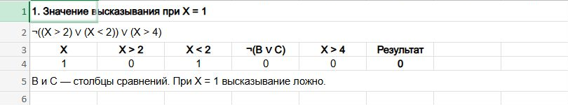
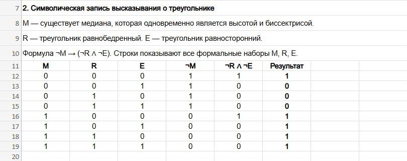
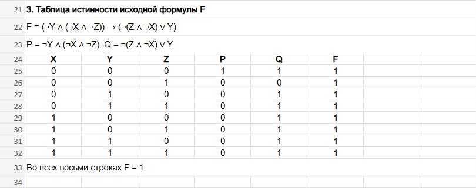

# Домашнее задание № 1 — алгебра логики, вариант 11

У каждого задания отдельный файл Excel. В таблицах 1 означает «истина», 0 — «ложь». Скриншоты показывают те же таблицы на исходном общем листе.

## Задание 1. Найти значение при X = 1

[Скачать Excel для задания 1](excel/task-1.xlsx)

В выражении `¬((X > 2) ∨ (X < 2)) ∨ (X > 4)` сначала проверяю три сравнения. При X = 1 получаю 0, 1 и 0. Первые два результата соединяю через ИЛИ и отрицаю. Получается `¬(0 ∨ 1) = 0`. Осталось `0 ∨ 0 = 0`, поэтому высказывание ложно.

## Задание 2. Записать высказывание о треугольнике формулой

[Скачать Excel для задания 2](excel/task-2.xlsx)

Обозначаю через M высказывание «есть медиана, которая одновременно является высотой и биссектрисой». R означает «треугольник равнобедренный», E — «треугольник равносторонний».

Условие «такой медианы нет» записываю как ¬M. Заключение «треугольник не равнобедренный и не равносторонний» даёт ¬R ∧ ¬E. Получается `¬M → (¬R ∧ ¬E)`. В Excel перебираю восемь наборов M, R и E и вычисляю обе части импликации. Импликация даёт 0, когда условие истинно, а заключение ложно.

## Задание 3. Построить таблицу истинности

[Скачать Excel для задания 3](excel/task-3.xlsx)

Для формулы `F = (¬Y ∧ (¬X ∧ ¬Z)) → (¬(Z ∧ ¬X) ∨ Y)` выписываю восемь наборов X, Y и Z. Левую часть считаю в столбце P, правую — в Q. Для последнего столбца использую `P → Q ≡ ¬P ∨ Q`.

P равна 1 только при X = Y = Z = 0. В этой строке Q тоже равна 1. В остальных строках P равна 0, поэтому F получается равной 1 во всех восьми строках.

